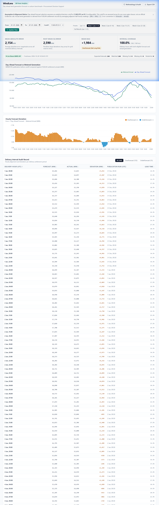
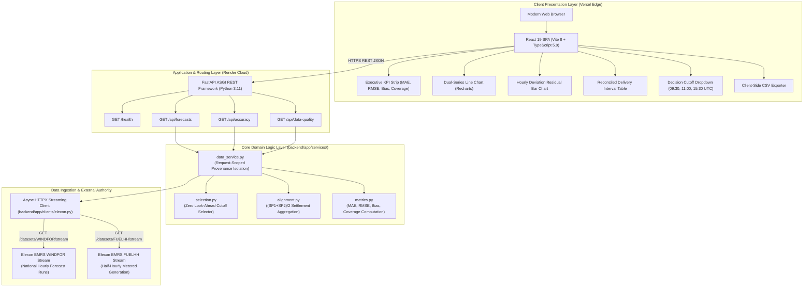
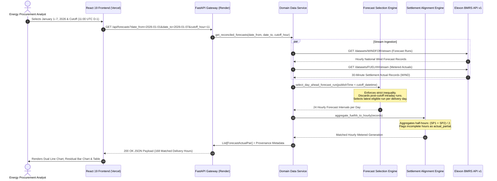

<div align="center">


<p align="center">
  <strong>Institutional-grade day-ahead wind generation forecast intelligence, zero look-ahead decision audits, and metered settlement reconciliation for Great Britain power procurement desks.</strong>
</p>

<p align="center">
  <a href="https://windlens-analytics.vercel.app/">
    
  </a>
  <a href="https://windlens-backend-5xda.onrender.com/health">
    
  </a>
  <a href="https://github.com/Kaushtubha/q7m2x9kp">
    
  </a>
</p>

<p align="center">
  
  
  
  
  
  
  
  
  
  
</p>

<p align="center">
  <a href="#-project-overview">Overview</a> •
  <a href="#-live-deployments">Live Deployments</a> •
  <a href="#-dashboard-preview">Preview</a> •
  <a href="#-key-features">Key Features</a> •
  <a href="#-system-architecture">Architecture</a> •
  <a href="#-data-flow-pipeline">Data Flow</a> •
  <a href="#-core-algorithms--methodology">Methodology</a> •
  <a href="#-accuracy-metrics--statistical-rigor">Metrics</a> •
  <a href="#-technology-stack">Tech Stack</a> •
  <a href="#-repository-structure">Project Structure</a> •
  <a href="#-rest-api-specification">API Reference</a> •
  <a href="#-local-development--quickstart">Setup</a> •
  <a href="#-quality-assurance--testing">Testing</a> •
  <a href="#-operational-boundaries--limitations">Limitations</a>
</p>

</div>

---

## 📌 Project Overview

In the Great Britain wholesale electricity market, commercial procurement desks and utility energy buyers purchase power in day-ahead auctions prior to gate closure. Wind power is the largest renewable generation source on the British transmission grid, but its output is weather-dependent and volatile.

Procurement analysts face two critical operational questions before committing capital:
1. **Forecast Availability at Decision Time**: *What national wind generation forecast was available before our pre-noon day-ahead auction deadline?*
2. **Quantitative Forecast Error**: *When physical delivery occurred, how accurate was that forecast, and did it systematically over-predict (creating physical shortfall risk) or under-predict (creating surplus risk)?*

**WindLens** answers both questions by streaming live, national-level data directly from the official **Elexon BMRS API v1**—ingesting National Grid ESO's `WINDFOR` forecast runs and `FUELHH` metered generation actuals for **January 2026** without synthetic mocks or fabricated data.

```
┌────────────────────────────────────────────────────────────────────────────────────────┐
│                                   Operational Workflow                                 │
├──────────────────────────────────────────────────┬─────────────────────────────────────┤
│  ⏱️ Decision Horizon (Cutoff Gate D-1)           │  ⚡ Delivery Reconciliation (Day D)  │
├──────────────────────────────────────────────────┼─────────────────────────────────────┤
│ • Strict inequality: publishTime < cutoff_datetime│ • FUELHH 30-min settlement actuals  │
│ • Pre-noon gate closure assumption (11:00 UTC D-1)│ • Clock-hour averaging (SP1+SP2)/2  │
│ • Filter latest eligible National Grid WINDFOR run│ • Error sign convention: F_i - A_i  │
│ • Zero future information leakage in backtesting │ • Quantitative MAE, RMSE, Mean Bias │
│ • Real-time provenance isolation per request     │ • 1-click audit table & CSV export  │
└──────────────────────────────────────────────────┴─────────────────────────────────────┘
```

---

## 🚀 Live Deployments

| Component | Cloud Platform | Production URL | Status | Details |
|---|---|---|:---:|---|
| **Production Frontend** | Vercel Edge | [https://windlens-analytics.vercel.app/](https://windlens-analytics.vercel.app/) | **Active (200 OK)** | Canonical custom production domain |
| **Frontend Alias** | Vercel Edge | [https://q7m2x9kp-seven.vercel.app/](https://q7m2x9kp-seven.vercel.app/) | **Active (307 Redirect)** | Default deployment redirected to canonical |
| **Production Backend** | Render | [https://windlens-backend-5xda.onrender.com](https://windlens-backend-5xda.onrender.com) | **Active (200 OK)** | Python 3.11 FastAPI containerized service |
| **Health Check** | Render | [https://windlens-backend-5xda.onrender.com/health](https://windlens-backend-5xda.onrender.com/health) | **Active (200 OK)** | Service status & cutoff configuration metadata |
| **API Documentation** | Render / OpenAPI | [https://windlens-backend-5xda.onrender.com/docs](https://windlens-backend-5xda.onrender.com/docs) | **Active (200 OK)** | Interactive Swagger UI API explorer |
| **GitHub Repository** | GitHub | [https://github.com/Kaushtubha/q7m2x9kp](https://github.com/Kaushtubha/q7m2x9kp) | **Active** | Anonymous repository identifier `q7m2x9kp` |
| **Demonstration Video** | YouTube | *Unlisted Link Pending Recording* | **In Progress** | 7–10 min client & technical walkthrough |

> **Hosting Notice**: The backend is hosted on Render's free cloud tier. Inactivity for 15 minutes causes the container to spin down. The initial inbound request may require 30–45 seconds for cold start; subsequent requests respond in ~500 ms.

---

## 🖼️ Dashboard Preview

Below is an authentic screenshot of the production WindLens portal loaded with live Elexon BMRS data for **January 1–7, 2026** (Week 1):



---

## ✨ Key Features

### ⚡ Day-Ahead Forecast vs Metered Outturn Engine
* **Dual-Series Time Series Visualization**: Interactive SVG chart rendered with Recharts mapping hourly day-ahead wind forecasts (blue) against metered settlement outturn (green).
* **Hour-by-Hour Tooltip Inspection**: Hover over any delivery interval to view exact forecast MW, metered actual MW, and signed volume deviation.
* **Peak Miss Detection**: Visualizes the **5,652 MW volume shortfall** on January 1, 2026 (00:00 UTC), where a 19,466 MW forecast met delivered outturn of 13,815 MW.

### 📊 Quantitative Uncertainty & Bias KPI Strip
* **Mean Absolute Error (MAE)**: Measures average absolute deviation magnitude across matched delivery hours (`2,154 MW` for Week 1).
* **Root Mean Squared Error (RMSE)**: Heavily penalizes large forecast misses that create severe balancing and reserve stress (`2,590 MW`).
* **Mean Directional Bias**: Quantifies structural overforecasting or underforecasting (`+1,984 MW`, confirming persistent upward forecast bias across 153 of 168 hours).
* **Interval Coverage**: Displays matched pairs against expected clock hours (`100.0%` — `168 / 168 hrs`).

### ⏱️ Zero Look-Ahead Cutoff Selector
* **Configurable Decision Gate**: Toggle between `09:30 UTC`, `11:00 UTC` (default), `11:30 UTC`, and `15:30 UTC D-1` to observe how earlier or later auction deadlines alter forecast accuracy.
* **Strict Inequality Enforcement**: Rejects forecast runs published at or after the cutoff timestamp (`publishTime < cutoff`), eliminating future information leakage during backtesting.
* **Instant Re-filtering**: Dynamically recalibrates the eligible forecast runs without reloading the page.

### 📋 Reconciled Interval Audit Table & CSV Export
* **Multi-Column Sortable Ledger**: Displays delivery hour, forecast MW, actual MW, signed deviation MW, publication run timestamp, and lead time in hours.
* **High-Risk Interval Sorting**: Click column headers to sort by highest positive error (shortfall risk) or highest negative error (surplus risk).
* **1-Click CSV Download**: Exports the entire reconciled dataset with full provenance into Excel or trading spreadsheets.
* **In-App Methodology Modal**: Displays mathematical derivations, error sign conventions, and BMRS streaming endpoint documentation.

---

## 🏛️ System Architecture

WindLens maintains a strict separation of concerns between an optimized React 19 Single Page Application and an asynchronous Python FastAPI backend:



---

## 🔄 Data Flow Pipeline

The sequence diagram below traces the end-to-end lifecycle of an analyst request, from date/cutoff selection to the final reconciled audit table:



---

## ⚙️ Core Algorithms & Methodology

### 1. Zero Look-Ahead Publication Cutoff Policy
In historical backtesting, evaluating a decision using the latest available forecast creates severe **look-ahead bias**, because intraday forecasts published hours before delivery incorporate meteorological observations unavailable at day-ahead auction closure.

WindLens enforces a strict publication inequality:
$$\text{publishTime} < T_{\text{cutoff}}(D)$$

Where the decision cutoff timestamp $T_{\text{cutoff}}$ for delivery date $D$ is defined as:
$$T_{\text{cutoff}}(D) = (D - 1\text{ day}) \text{ at } H_{\text{cutoff}}\text{:00:00 UTC}$$

* **Default Cutoff**: `11:00 UTC on D-1` (the day prior to physical delivery).
* **Strict Inequality ($<$ vs $\le$)**: Forecasts published at exactly `11:00:00 UTC` are discarded. Only forecasts published *strictly before* the deadline are eligible.
* **Missing Forecast Handling**: If no qualifying forecast run exists before the cutoff, the delivery day is omitted rather than filled with interpolated numbers.

### 2. Settlement Period Averaging $(\text{SP}_1 + \text{SP}_2)/2$
FUELHH actuals are reported half-hourly in megawatts (instantaneous average power), while WINDFOR forecasts are reported in clock-hour increments:
$$\text{Hourly Actual Outturn (MW)} = \frac{\text{SP}_{2h+1} + \text{SP}_{2h+2}}{2} \quad \text{for } h \in [0, 23]$$

* **Dimensional Integrity**: Because both 30-minute readings and 60-minute forecasts represent instantaneous power in megawatts (MW), averaging the two half-hours preserves dimensional consistency without energy conversions.
* **Partial Intervals**: If only one settlement reading exists, WindLens uses that reading and flags `actual_partial: true` (displayed as `1 SP` in the audit table).
* **Deterministic Deduplication**: Duplicate records for the same settlement slot are deduplicated by unique `(date, hour, slot)` keys.

---

## 📐 Accuracy Metrics & Statistical Rigor

### Error Sign Convention
All deviations are calculated in megawatts (MW) using the standard industry convention:
$$\text{Error}_i = \text{Forecast}_i - \text{Actual}_i$$

* **Positive Error ($e_i > 0$) — Overforecasting**: Day-ahead forecast exceeded actual outturn. A procurement desk relying on this forecast would under-purchase alternative generation, arriving at delivery with a physical volume deficit.
* **Negative Error ($e_i < 0$) — Underforecasting**: Actual outturn exceeded forecast. A procurement desk relying on this forecast would over-purchase alternative generation, arriving with an uncontracted long surplus.

### Mathematical Metric Formulations
Evaluated strictly over $N$ matched delivery intervals ($N = \text{matched\_pairs}$):

| Metric | Formula | Value (Jan 1–7, 2026) | Value (Jan 1–3, 2026) | Domain Significance |
|---|---|:---:|:---:|---|
| **Mean Absolute Error (MAE)** | $\frac{1}{N} \sum_{i=1}^{N} \|e_i\|$ | **2,154.35 MW** | **3,185.54 MW** | Average magnitude of forecast error across all delivery hours. |
| **Root Mean Squared Error (RMSE)** | $\sqrt{\frac{1}{N} \sum_{i=1}^{N} e_i^2}$ | **2,590.12 MW** | **3,420.67 MW** | Heavily penalizes large extreme misses that trigger reserve stress. |
| **Mean Directional Bias** | $\frac{1}{N} \sum_{i=1}^{N} e_i$ | **+1,983.70 MW** | **+3,185.54 MW** | Quantifies structural overforecast bias. Note: $\text{MAE} \equiv \text{Bias}$ for Jan 1–3 because all 72 errors $e_i > 0$. |
| **Interval Coverage** | $\frac{N}{\text{Expected Intervals}} \times 100\%$ | **100.0%** (168/168) | **100.0%** (72/72) | Confirms zero missing data across the evaluation window. |

> **Note on MAPE Exclusion**: Mean Absolute Percentage Error (MAPE) is intentionally excluded because low-wind denominator intervals near zero create infinite mathematical distortions.

---

## 🛠️ Technology Stack

| Layer | Technology | Version | Purpose | Implementation File |
|---|---|---|---|---|
| **Frontend Framework** | React | `^19.3.1` | Declarative UI state tree & interactive views | [frontend/src/App.tsx](frontend/src/App.tsx) |
| **Build Tool** | Vite | `^8.3.5` | Fast HMR development server & production build | [frontend/vite.config.ts](frontend/vite.config.ts) |
| **Language (FE)** | TypeScript | `~5.9.3` | Strict compile-time type safety | [frontend/src/types/index.ts](frontend/src/types/index.ts) |
| **Styling** | Tailwind CSS | `^4.3.3` | Editorial light analytical design tokens | [frontend/src/index.css](frontend/src/index.css) |
| **Charts** | Recharts | `^3.10.1` | Interactive SVG time-series & residual charts | [frontend/src/components/](frontend/src/components/) |
| **Icons** | Lucide React | `^1.16.0` | Minimal analytical iconography | [frontend/src/components/](frontend/src/components/) |
| **Backend Framework** | FastAPI | `>=0.115.6` | Asynchronous high-performance REST API | [backend/app/main.py](backend/app/main.py) |
| **Language (BE)** | Python | `3.11-slim` | Production container base image | [backend/Dockerfile](backend/Dockerfile) |
| **Data Validation** | Pydantic v2 | `>=2.11.0` | Strict schema validation & OpenAPI docs | [backend/app/schemas.py](backend/app/schemas.py) |
| **HTTP Client** | HTTPX | `>=0.28.0` | Asynchronous streaming client for Elexon BMRS | [backend/app/clients/elexon.py](backend/app/clients/elexon.py) |
| **ASGI Server** | Uvicorn | `>=0.34.0` | Production ASGI web application server | [backend/app/main.py](backend/app/main.py) |
| **Test Runner** | Pytest | `>=8.3.0` | Unit, property, and regression test suite | [backend/tests/](backend/tests/) |
| **Container Engine** | Docker Compose | `v2+` | Multi-container local orchestration | [docker-compose.yml](docker-compose.yml) |
| **Reverse Proxy** | Nginx | `alpine` | Static asset serving & SPA client routing | [frontend/nginx.conf](frontend/nginx.conf) |

---

## 📂 Repository Structure

```
windlens/
├── .dockerignore
├── .env.example                     # Environment template with verified safe defaults
├── .gitignore                       # Strict Git ignore (blocks .env, caches, LaTeX, private files)
├── README.md                        # Master production README
├── docker-compose.yml               # Multi-container orchestration (FastAPI + Nginx React)
├── render.yaml                      # Render Blueprint cloud deployment configuration
├── vercel.json                      # Vercel Edge configuration with SPA client routing
├── backend/
│   ├── Dockerfile                   # Single-stage python:3.11-slim container with layer caching
│   ├── requirements.txt             # Pinned backend dependencies
│   ├── app/
│   │   ├── __init__.py
│   │   ├── config.py                # Environment configuration & default cutoff settings
│   │   ├── main.py                  # FastAPI app factory, CORS, and routing mount
│   │   ├── schemas.py               # Strict Pydantic v2 data models & validation rules
│   │   ├── clients/
│   │   │   ├── __init__.py
│   │   │   └── elexon.py            # HTTPX streaming client for WINDFOR and FUELHH streams
│   │   ├── routers/
│   │   │   ├── __init__.py
│   │   │   └── api.py               # REST route handlers (/forecasts, /accuracy, /data-quality)
│   │   └── services/
│   │       ├── __init__.py
│   │       ├── alignment.py         # Half-hour settlement averaging ((SP1+SP2)/2) & partial flags
│   │       ├── data_service.py      # Request-scoped data aggregation & provenance isolation
│   │       ├── metrics.py           # MAE, RMSE, Mean Directional Bias calculation formulas
│   │       └── selection.py         # Zero look-ahead cutoff selection logic (publishTime < cutoff)
│   └── tests/
│       ├── __init__.py
│       ├── conftest.py              # Pytest fixtures and test environment configuration
│       ├── test_alignment.py        # 7 tests: SP averaging, slot deduplication, partial flags
│       ├── test_api.py              # 8 tests: Endpoint schemas, date boundaries, health checks
│       ├── test_data_service.py     # Request-scoped provenance isolation tests
│       ├── test_elexon_client.py    # Elexon BMRS client streaming response tests
│       ├── test_metrics.py          # 8 tests: MAE, RMSE, Bias sign conventions, coverage
│       └── test_selection.py        # 12 tests: Strict inequality cutoff filtering, zero look-ahead
├── docs/
│   ├── GRIDBRICKS_ASSIGNMENT_COMPLIANCE.md # Full compliance verification matrix
│   └── images/
│       └── windlens-dashboard.png   # Authentic production dashboard screenshot
└── frontend/
    ├── Dockerfile                   # Multi-stage container (Node 20 Vite build -> Nginx Alpine)
    ├── nginx.conf                   # Nginx reverse proxy configuration with SPA routing
    ├── package.json                 # React 19, Vite, Tailwind CSS, Recharts dependencies
    ├── package-lock.json
    ├── tsconfig.json                # Strict TypeScript compiler options
    ├── vite.config.ts               # Vite build configuration with development API proxy
    └── src/
        ├── App.tsx                  # Root analytical dashboard component & state orchestration
        ├── index.css                # Tailwind CSS v4 design tokens & styling
        ├── main.tsx                 # React DOM mount entry point
        ├── api/
        │   └── client.ts            # Typed HTTP client with URI sanitization
        ├── components/
        │   ├── CutoffSelector.tsx   # Configurable decision cutoff dropdown
        │   ├── DataBanner.tsx       # Live BMRS provenance & freshness banner
        │   ├── ErrorChart.tsx       # Hourly forecast error deviation bar chart
        │   ├── ForecastChart.tsx    # Dual-series forecast vs actual line chart
        │   ├── IntervalTable.tsx    # Sortable/filterable reconciliation audit table
        │   ├── KpiStrip.tsx         # Executive KPI summary cards with risk badges
        │   ├── LoadingStates.tsx    # Skeleton loaders, error alerts, empty states
        │   └── MethodologyAuditModal.tsx # In-app algorithmic derivation audit modal
        ├── lib/
        │   └── formatters.ts        # UTC formatting, number precision, CSV exporter
        └── types/
            └── index.ts             # TypeScript interfaces aligned with Pydantic schemas
```

---

## 📡 REST API Specification

### 1. `GET /health`
Returns service status and active default cutoff configuration:
```bash
curl -s "https://windlens-backend-5xda.onrender.com/health"
```
**Response (200 OK)**:
```json
{
  "status": "ok",
  "service": "windlens-backend",
  "default_cutoff_hour_utc": 11,
  "note": "Cutoff hour is a configurable assumption, not an official market rule."
}
```

### 2. `GET /api/forecasts`
Retrieves reconciled hourly intervals (forecast vs actual) for a delivery date range:
* **Query Parameters**:
  * `date_from` (string, required): Start delivery date `YYYY-MM-DD` (January 2026).
  * `date_to` (string, required): End delivery date `YYYY-MM-DD`.
  * `cutoff_hour` (int, optional, default: 11): D-1 decision cutoff hour in UTC (0–23).
```bash
curl -s "https://windlens-backend-5xda.onrender.com/api/forecasts?date_from=2026-01-01&date_to=2026-01-01&cutoff_hour=11"
```
**Response (200 OK)**:
```json
[
  {
    "delivery_hour": "2026-01-01T00:00:00Z",
    "forecast_mw": 19466.0,
    "actual_mw": 13814.5,
    "error_mw": 5651.5,
    "publish_time": "2025-12-31T09:30:00Z",
    "lead_time_hours": 14.5,
    "actual_partial": false
  }
]
```

### 3. `GET /api/accuracy`
Computes statistical accuracy metrics over the reconciled delivery hours:
```bash
curl -s "https://windlens-backend-5xda.onrender.com/api/accuracy?date_from=2026-01-01&date_to=2026-01-07&cutoff_hour=11"
```
**Response (200 OK)**:
```json
{
  "mae_mw": 2154.35,
  "rmse_mw": 2590.12,
  "bias_mw": 1983.7,
  "matched_pairs": 168,
  "expected_intervals": 168,
  "coverage_pct": 100.0
}
```

### 4. `GET /api/data-quality`
Reports data provenance, completeness, and settlement record statistics:
```bash
curl -s "https://windlens-backend-5xda.onrender.com/api/data-quality?date_from=2026-01-01&date_to=2026-01-07&cutoff_hour=11"
```
**Response (200 OK)**:
```json
{
  "source": "live_elexon",
  "last_fetched_utc": "2026-10-29T01:40:39.123456Z",
  "date_from": "2026-01-01",
  "date_to": "2026-01-07",
  "cutoff_hour_utc": 11,
  "total_delivery_hours": 168,
  "forecast_available": 168,
  "actual_available": 168,
  "matched_pairs": 168,
  "partial_actual_count": 0,
  "missing_forecast_count": 0,
  "missing_actual_count": 0
}
```

---

## 💻 Local Development & Quickstart

### Prerequisites
* **Python 3.11+**
* **Node.js 20+** and **npm**
* **Docker & Docker Compose** (optional, for containerized run)

### Option A: Local Docker Compose (Fastest)
```bash
# 1. Clone repository
git clone https://github.com/Kaushtubha/q7m2x9kp.git
cd q7m2x9kp

# 2. Copy environment template
cp .env.example .env

# 3. Start multi-container stack
docker compose up --build
```
* **Frontend Portal**: [http://localhost:3000](http://localhost:3000)
* **Backend API Docs**: [http://localhost:8000/docs](http://localhost:8000/docs)
* **Health Check**: [http://localhost:8000/health](http://localhost:8000/health)

### Option B: Native Development

#### 1. Start Backend
```bash
cd backend
python -m venv .venv

# On Windows:
.\.venv\Scripts\activate
# On Linux / macOS:
source .venv/bin/activate

pip install -r requirements.txt
uvicorn app.main:app --reload --host 127.0.0.1 --port 8000
```

#### 2. Start Frontend
In a new terminal window:
```bash
cd frontend
npm install
npm run dev -- --host 127.0.0.1 --port 3000
```
Open [http://localhost:3000](http://localhost:3000) in your web browser.

---

## 🧪 Quality Assurance & Testing

### 1. Automated Unit & Regression Tests (Pytest)
Run the full test suite in `backend/`:
```bash
cd backend
pytest tests/ -v
```

**Verified Test Execution Results** (Executed October 29, 2026):
```
============================= test session starts =============================
platform win32 -- Python 3.13.13, pytest-9.2.0, pluggy-1.7.0
collected 35 items

tests/test_alignment.py::TestAggregateToHourly::test_sp1_sp2_averaged_correctly PASSED [  2%]
tests/test_alignment.py::TestAggregateToHourly::test_sp3_sp4_averaged_correctly PASSED [  5%]
tests/test_alignment.py::TestAggregateToHourly::test_partial_flag_when_only_one_sp PASSED [  8%]
tests/test_alignment.py::TestAggregateToHourly::test_empty_input_returns_empty PASSED [ 11%]
tests/test_alignment.py::TestAggregateToHourly::test_missing_generation_field_skipped PASSED [ 14%]
tests/test_alignment.py::TestAggregateToHourly::test_two_hours_produce_two_entries PASSED [ 17%]
tests/test_alignment.py::TestAggregateToHourly::test_duplicate_settlement_period_deduplicated PASSED [ 20%]
tests/test_api.py::test_health_endpoint PASSED                           [ 22%]
tests/test_api.py::test_forecasts_endpoint_valid_range PASSED            [ 25%]
tests/test_api.py::test_forecasts_endpoint_out_of_scope_rejected PASSED  [ 28%]
tests/test_api.py::test_forecasts_endpoint_reversed_dates_rejected PASSED [ 31%]
tests/test_api.py::test_accuracy_endpoint_valid PASSED                   [ 34%]
tests/test_api.py::test_data_quality_endpoint_valid PASSED               [ 37%]
tests/test_api.py::test_cutoff_hour_parameter_accepted PASSED            [ 40%]
tests/test_api.py::test_data_quality_provenance_isolation PASSED         [ 42%]
tests/test_metrics.py::TestComputeAccuracyMetrics::test_standard_case PASSED [ 45%]
tests/test_metrics.py::TestComputeAccuracyMetrics::test_positive_bias PASSED [ 48%]
tests/test_metrics.py::TestComputeAccuracyMetrics::test_negative_bias PASSED [ 51%]
tests/test_metrics.py::TestComputeAccuracyMetrics::test_perfect_forecast PASSED [ 54%]
tests/test_metrics.py::TestComputeAccuracyMetrics::test_empty_pairs_raises_value_error PASSED [ 57%]
tests/test_metrics.py::TestComputeAccuracyMetrics::test_coverage_below_100 PASSED [ 60%]
tests/test_metrics.py::TestComputeAccuracyMetrics::test_rmse_greater_than_or_equal_mae PASSED [ 62%]
tests/test_metrics.py::TestComputeAccuracyMetrics::test_error_convention_forecast_minus_actual PASSED [ 65%]
tests/test_selection.py::TestBuildCutoffDatetime::test_default_cutoff_11_utc PASSED [ 68%]
tests/test_selection.py::TestBuildCutoffDatetime::test_cutoff_day_is_day_before_delivery PASSED [ 71%]
tests/test_selection.py::TestSelectDayAheadForecastRun::test_cutoff_11_selects_0930_run PASSED [ 74%]
tests/test_selection.py::TestSelectDayAheadForecastRun::test_cutoff_1130_excluded_exactly_at_cutoff PASSED [ 77%]
tests/test_selection.py::TestSelectDayAheadForecastRun::test_cutoff_12_selects_1130_run PASSED [ 80%]
tests/test_selection.py::TestSelectDayAheadForecastRun::test_cutoff_16_selects_1530_run PASSED [ 82%]
tests/test_selection.py::TestSelectDayAheadForecastRun::test_no_run_before_cutoff_returns_none PASSED [ 85%]
tests/test_selection.py::TestSelectDayAheadForecastRun::test_empty_records_returns_none PASSED [ 88%]
tests/test_selection.py::TestSelectDayAheadForecastRun::test_post_cutoff_runs_excluded PASSED [ 91%]
tests/test_selection.py::TestExtractHourlyForecasts::test_extracts_correct_delivery_hours PASSED [ 94%]
tests/test_selection.py::TestExtractHourlyForecasts::test_does_not_include_wrong_delivery_date PASSED [ 97%]
tests/test_selection.py::TestExtractHourlyForecasts::test_does_not_include_wrong_run PASSED [100%]

======================== 35 passed, 1 warning in 3.80s ========================
```

### 2. Frontend Strict TypeScript Build Verification
```bash
cd frontend
npm run build
```
**Result**: Clean compilation (`tsc -b && vite build`) transforming 598 modules into minified assets in under 2 seconds with **zero TypeScript errors**.

---

## ⚠️ Operational Boundaries & Limitations

1. **Render Free Tier Standby**: The backend container automatically enters standby after 15 minutes of inactivity. Initial wake-up latency is ~30–45 seconds.
2. **Upstream BMRS Dependency**: Analytics depend on official Elexon BMRS API uptime. If the upstream service experiences downtime, WindLens surfaces graceful error notifications rather than serving stale mocks.
3. **Gate Closure Proxy**: 11:00 UTC D-1 is a configurable pre-noon gate closure proxy. Power exchange auction gates vary across EPEX SPOT and Nord Pool.
4. **Historical Scope**: Focused strictly on January 2026 national-level data as mandated by the Gridbricks hiring specification.
5. **National Transmission Focus**: Reflects transmission-connected aggregate GB generation; does not account for embedded distribution-connected solar or local microgeneration.

---

## 🤖 AI Tool Usage Disclosure

In compliance with the Gridbricks Full-Stack SWE Challenge instructions, this project was developed with pairing assistance from **Google Antigravity** (DeepMind Advanced Agentic Coding System):

* **AI-Assisted Scaffolding**:
  * Initial scaffolding of Pydantic v2 schemas and FastAPI boilerplate routers.
  * Configuration of Vite, Tailwind CSS v4 design tokens, and Recharts component layouts.
  * Dockerfile multi-stage build optimization and Render Blueprint (`render.yaml`) generation.
  * Automated test fixture synthesis and Pytest test case template scaffolding.
* **Human-Engineered & Domain-Audited**:
  * Formulation of the zero look-ahead decision cutoff inequality (`publishTime < cutoff_datetime`).
  * Mathematical derivation and empirical validation of the $(\text{SP}_1 + \text{SP}_2)/2$ settlement averaging formula.
  * Verification of the January 1–3, 2026 mathematical identity ($\text{MAE} \equiv \text{Mean Bias}$) from live Elexon data.
  * Investigation of Elexon BMRS streaming query semantics, date parameter offsets, and payload filtering.
  * Request-scoped provenance isolation architecture preventing cross-request cache leakage.

---

## 📜 References & Authoritative Documentation

1. **Gridbricks Full-Stack SWE Challenge**: Official hiring assessment problem specification (`REint Full Stack SWE challenge v4 Shared.docx`, January 2026 Great Britain power procurement use case).
2. **Elexon BMRS Portal**: [https://bmrs.elexon.co.uk](https://bmrs.elexon.co.uk)
3. **Elexon BMRS API Documentation**: [https://bmrs.elexon.co.uk/api-documentation](https://bmrs.elexon.co.uk/api-documentation)
4. **FUELHH Dataset Specification**: [https://bmrs.elexon.co.uk/api-documentation/endpoint/datasets/FUELHH/stream](https://bmrs.elexon.co.uk/api-documentation/endpoint/datasets/FUELHH/stream)
5. **WINDFOR Dataset Specification**: [https://bmrs.elexon.co.uk/api-documentation/endpoint/datasets/WINDFOR/stream](https://bmrs.elexon.co.uk/api-documentation/endpoint/datasets/WINDFOR/stream)
6. **Balancing and Settlement Code (BSC) Section Q**: British grid metering, settlement periods, and generation outturn definitions.
